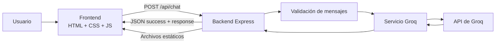
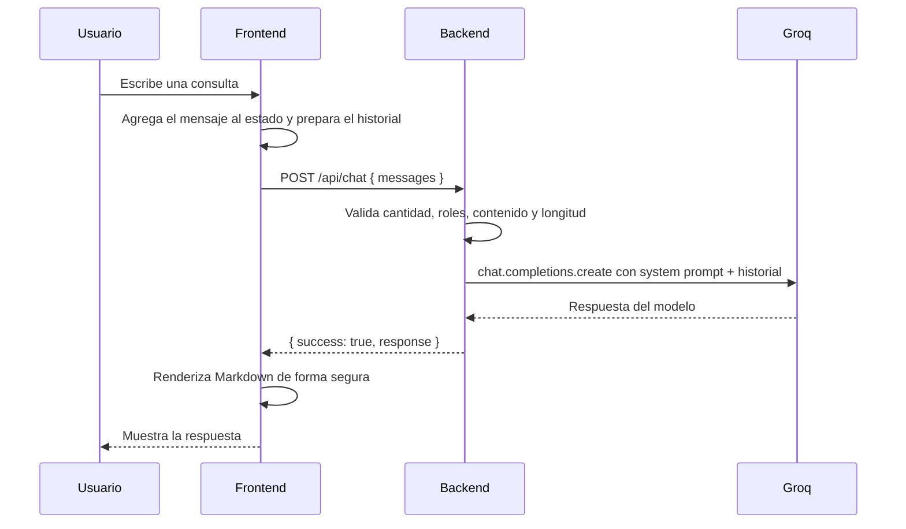

# Documentación del Proyecto

## Asistente de Viajes Uruguay

### Parcial 2 – Proyecto de Inteligencia Artificial

| Campo | Detalle |
|---|---|
| Proyecto | Asistente de Viajes Uruguay |
| Tipo de entrega | Parcial 2 – Proyecto de Inteligencia Artificial |
| Materia | Inteligencia Artificial |
| Autor | [Gaston Da Silva] |
| Fecha | Octubre de 2026 |
| Repositorio | https://github.com/Gastooonnn/chat-ia |

> **Nota de consistencia.** Este documento describe el comportamiento real del código del repositorio. El `README.md` todavía menciona Google Gemini y una estructura anterior; la implementación activa utiliza **Groq** a través de `backend/src/services/groq.service.js`. Las diferencias se detallan en la sección 14.

---

## Contenido

1. Resumen ejecutivo
2. Consignas del parcial y cumplimiento
3. Descripción del problema
4. Propuesta de solución
5. Justificación del uso de Inteligencia Artificial
6. Arquitectura del sistema
7. Desarrollo e integración del modelo LLM
8. Configuración y diseño del prompt
9. Frontend
10. Backend y API
11. Instalación, configuración y ejecución
12. Guion de exposición
13. Pruebas y verificación
14. Limitaciones y mejoras futuras
15. Conclusiones
16. Anexos

---

## 1. Resumen ejecutivo

**Asistente de Viajes Uruguay** es una aplicación web que permite conversar con un asistente virtual especializado en turismo uruguayo. El usuario puede consultar por destinos, playas, ciudades, gastronomía, actividades, presupuestos e itinerarios, y recibir respuestas personalizadas generadas por un modelo de lenguaje (LLM).

La solución combina:

- Un **frontend estático** desarrollado con HTML5, CSS3 y JavaScript vanilla.
- Un **backend** con Node.js y Express que sirve el frontend y expone el endpoint `POST /api/chat`.
- Un **modelo LLM** accedido mediante la API de **Groq**.
- Un **prompt de sistema** que define el rol, el objetivo, el tono, el contexto y las restricciones del asistente.
- Validaciones de entrada y medidas básicas de seguridad, como el resguardo de la API key en el backend y el escape de HTML antes de renderizar respuestas.

El proyecto busca resolver un problema concreto: la dificultad de planificar un viaje por Uruguay cuando la información está dispersa, no está adaptada a cada viajero y requiere comparar muchas alternativas. La aplicación convierte esa información en una conversación guiada y personalizada.

---

## 2. Consignas del parcial y cumplimiento

El enunciado del parcial, contenido en el archivo `PARCIAL 2 – PROYECTO DE INTELIGENCIA ARTIFICIAL.pdf`, presenta una página con cinco consignas:

1. **Descripción del problema:** describir una problemática concreta de una empresa real o ficticia que pueda ser abordada mediante Inteligencia Artificial.
2. **Propuesta de solución y justificación del uso de IA:** presentar una solución y justificar por qué la IA resulta adecuada.
3. **Desarrollo e integración de un modelo LLM:** desarrollar una solución funcional que integre un modelo de lenguaje, utilizando una herramienta, plataforma o API.
4. **Configuración del sistema y diseño del prompt:** definir rol, objetivo, contexto, forma y estilo, restricciones y estructura esperada de las respuestas.
5. **Exposición del proyecto:** realizar una presentación breve de 5 a 10 minutos con problema, solución, uso de IA, modelo, herramientas y demostración.

### Matriz de cumplimiento

| # | Consigna | Cómo se aborda | Evidencia en el proyecto | Estado |
|---|---|---|---|---|
| 1 | Descripción del problema | Se define una agencia ficticia de asesoramiento turístico y una problemática concreta de planificación de viajes | Sección 3 de este documento | Cumple |
| 2 | Propuesta de solución y justificación de IA | Aplicación web con chat especializado, destinos destacados, historial y sugerencias rápidas; se justifica el uso de un LLM | Secciones 4 y 5 | Cumple |
| 3 | Desarrollo e integración de un LLM | Integración funcional con Groq mediante `groq-sdk` y el endpoint `POST /api/chat` | `backend/src/services/groq.service.js`, `backend/src/routes/chat.routes.js` | Cumple |
| 4 | Configuración y diseño del prompt | Prompt de sistema con rol, objetivo, contexto, estilo y restricciones | `backend/src/services/groq.service.js`, sección 8 | Cumple parcialmente: la estructura de respuesta no está impuesta de forma rígida |
| 5 | Exposición del proyecto | Guion de 5 a 10 minutos y secuencia de demostración | Sección 12 | Planificado |

> **Observación académica:** la consigna 4 pide una “estructura esperada de las respuestas”. El prompt actual orienta la organización de itinerarios por día y las alternativas económicas, pero no define una plantilla obligatoria para todo tipo de respuesta. En la sección 8.4 se propone una mejora concreta para cerrar esa brecha.

---

## 3. Descripción del problema

### 3.1 Empresa ficticia

Se toma como caso de estudio una agencia digital ficticia llamada **Asistente de Viajes Uruguay**, dedicada al asesoramiento turístico para viajeros que quieren recorrer Uruguay.

La empresa ofrece atención personalizada para:

- Turismo nacional y receptivo.
- Escapadas de fin de semana.
- Viajes familiares, en pareja o con amigos.
- Viajes de bajo presupuesto.
- Recorridos por la costa y el interior del país.

Su propuesta de valor es ayudar al viajero a decidir **qué visitar, cuándo, cómo organizarse y cuánto puede costar**, sin tener que consultar decenas de fuentes distintas.

### 3.2 Problemática concreta

Una persona quiere organizar un viaje por Uruguay, por ejemplo, una escapada de tres días a la costa de Rocha. Para tomar una decisión necesita resolver varias cuestiones al mismo tiempo:

- Qué destino elegir según sus intereses.
- Cómo distribuir el tiempo entre playas, actividades y descanso.
- Qué transporte utilizar.
- Dónde alojarse según el presupuesto.
- Qué actividades son adecuadas para la época del año.
- Cómo comparar alternativas sin perder horas leyendo información dispersa.

La información existe, pero está fragmentada entre blogs, redes sociales, mapas, sitios oficiales, agencias y recomendaciones personales. Cada fuente tiene un formato distinto y casi ninguna se adapta a las condiciones concretas del viajero.

Desde el punto de vista de la empresa, el problema es doble:

1. **Atención personalizada poco escalable:** responder consultas repetitivas consume tiempo humano y limita la cantidad de clientes que se pueden atender.
2. **Respuestas genéricas:** los folletos y catálogos no contemplan presupuesto, duración, cantidad de viajeros, intereses ni medio de transporte.

### 3.3 Usuarios principales

| Usuario | Necesidad principal |
|---|---|
| Turista nacional | Descubrir destinos y organizar escapadas con poco tiempo |
| Turista extranjero | Conocer opciones, distancias y combinaciones de lugares |
| Familias | Encontrar actividades y destinos adecuados para niños |
| Parejas | Planificar viajes cortos con propuestas variadas |
| Mochileros | Optimizar presupuesto, transporte y alojamiento |
| Agencia ficticia | Ofrecer asesoramiento 24/7 sin aumentar proporcionalmente su equipo |

### 3.4 Objetivo general

Diseñar e implementar un asistente conversacional con Inteligencia Artificial que ayude a los usuarios a descubrir destinos turísticos de Uruguay y a preparar itinerarios personalizados de forma clara, rápida y contextualizada.

### 3.5 Objetivos específicos

- Interpretar consultas en lenguaje natural sobre turismo en Uruguay.
- Recomendar destinos, playas, ciudades, actividades y gastronomía.
- Adaptar las respuestas al presupuesto, la duración, los intereses, la cantidad de viajeros y el transporte.
- Mantener el contexto de la conversación para permitir ajustes sin repetir información.
- Ofrecer sugerencias rápidas y tarjetas de destinos como punto de entrada.
- Evitar la invención de datos que requieran verificación en tiempo real, como precios, horarios, disponibilidad o clima.
- Proveer una interfaz responsive, accesible y fácil de usar.

### 3.6 Alcance de la solución

**Incluye:**

- Chat con un LLM especializado en turismo uruguayo.
- Historial conversacional en memoria durante la sesión.
- Ocho destinos destacados.
- Sugerencias rápidas de consultas.
- Diseño responsive.
- Validación de entradas y manejo básico de errores.

**No incluye:**

- Reservas de pasajes, alojamiento o excursiones.
- Pagos en línea.
- Consulta de disponibilidad, precios o clima en tiempo real.
- Cuentas de usuario.
- Persistencia de conversaciones en una base de datos.
- Panel administrativo.
- Autenticación o control de acceso.

---

## 4. Propuesta de solución

### 4.1 Descripción general

La solución es una aplicación web compuesta por una landing informativa y un chat integrado. El usuario puede iniciar la conversación desde el botón principal, desde una sugerencia rápida o desde la tarjeta de un destino.

El backend recibe el historial de mensajes, valida la estructura y el tamaño del contenido, y envía la conversación al modelo de Groq junto con un prompt de sistema. La respuesta se devuelve al frontend y se renderiza como texto enriquecido de forma segura.

### 4.2 Funcionalidades implementadas

| Funcionalidad | Descripción | Referencia |
|---|---|---|
| Chat con IA | Envía mensajes y recibe respuestas del LLM | `frontend/js/app.js:245`, `backend/src/routes/chat.routes.js:36` |
| Historial conversacional | Conserva los últimos mensajes para mantener el contexto | `frontend/js/app.js:293` |
| Sugerencias rápidas | Botones con consultas predefinidas | `frontend/index.html:81`, `frontend/js/app.js:211` |
| Destinos destacados | Ocho tarjetas con imagen, descripción y botón de consulta | `frontend/js/app.js:20`, `frontend/js/app.js:412` |
| Indicador de escritura | Muestra que el asistente está generando una respuesta | `frontend/js/app.js:386` |
| Renderizado de Markdown | Convierte encabezados, negritas, cursivas, listas y código | `frontend/js/app.js:335` |
| Escape de HTML | Mitiga inyecciones de HTML en el contenido | `frontend/js/app.js:455` |
| Diseño responsive | Adaptación a escritorio, tablet y móvil | `frontend/css/styles.css:1145` |
| Navegación móvil | Menú desplegable con control de estado ARIA | `frontend/js/app.js:156` |
| Manejo de errores | Mensaje genérico si falla la API | `frontend/js/app.js:282` |
| Validación de entrada | Límites de cantidad y longitud de mensajes | `backend/src/routes/chat.routes.js:9` |
| Configuración por entorno | API key y modelo fuera del código | `backend/.env.example` |

### 4.3 Flujo de uso

1. El usuario abre la aplicación en `http://localhost:3000`.
2. Explora la portada y los destinos destacados.
3. Presiona “Comenzar conversación”, una sugerencia rápida o el botón de un destino.
4. Escribe una consulta o envía una consulta predefinida.
5. El frontend agrega el mensaje al estado y al historial.
6. El backend valida el payload y llama al servicio de Groq.
7. El modelo genera una respuesta usando el prompt de sistema y el historial.
8. El frontend renderiza la respuesta, actualiza el scroll y permite continuar la conversación.
9. Si ocurre un error, se muestra un mensaje genérico y se habilita nuevamente el envío.

### 4.4 Destinos destacados

| Destino | Enfoque de la recomendación |
|---|---|
| Montevideo | Rambla, casco histórico, mercados y vida cultural |
| Punta del Este | Playas, vida nocturna, gastronomía y escapadas |
| Colonia del Sacramento | Barrio histórico, patrimonio y atardeceres |
| Piriápolis | Cerros, castillo, puerto y playas familiares |
| La Paloma | Playas, surf, faro y ambiente relajado |
| Punta del Diablo | Playas salvajes, pesca y ambiente bohemio |
| Cabo Polonio | Dunas, lobos marinos, faro y naturaleza |
| Termas del Daymán | Turismo termal, descanso y bienestar |

---

## 5. Justificación del uso de Inteligencia Artificial

### 5.1 Por qué la IA es adecuada para este problema

El problema no consiste en buscar un registro exacto en una base de datos, sino en **interpretar una necesidad expresada en lenguaje natural** y construir una recomendación a partir de múltiples variables. La IA, y en particular un LLM, resulta adecuada por las siguientes razones:

| Necesidad | Aporte de la IA |
|---|---|
| Entender consultas abiertas | Procesa lenguaje natural aunque el usuario no use términos técnicos |
| Personalizar | Combina presupuesto, tiempo, intereses, transporte y cantidad de viajeros |
| Sintetizar información | Genera una respuesta organizada en lugar de devolver una lista de enlaces |
| Mantener contexto | Permite ajustar un itinerario sin repetir toda la conversación |
| Atender consultas variadas | No requiere una regla específica para cada combinación posible |
| Disponibilidad | Puede responder en cualquier horario dentro de los límites del servicio |

### 5.2 Por qué un LLM y no una solución basada en reglas

Una solución basada en reglas requeriría un árbol de decisión enorme para cubrir todos los destinos, presupuestos, duraciones, intereses y combinaciones posibles. Sería rígida, difícil de mantener y vulnerable a consultas redactadas de formas no previstas.

Un LLM permite:

- Aceptar preguntas ambiguas o incompletas.
- Pedir aclaraciones cuando faltan datos.
- Generar itinerarios y alternativas con una estructura comprensible.
- Adaptar el tono y el nivel de detalle.
- Aprovechar el contexto de los mensajes anteriores.

### 5.3 Por qué Groq

La implementación activa utiliza **Groq** como plataforma de inferencia. Sus ventajas para este proyecto son:

- API sencilla de integrar desde Node.js mediante `groq-sdk`.
- Respuestas rápidas, adecuadas para una interfaz de chat.
- Modelo configurable mediante la variable `GROQ_MODEL`.
- Separación clara entre la lógica de negocio y el proveedor del modelo.
- Facilidad para cambiar de modelo sin reescribir el frontend.

El proyecto conserva un servicio de Gemini de una etapa anterior, pero **no está conectado a la ruta activa**. La ruta `chat.routes.js` importa `generateResponse` desde `groq.service.js`.

### 5.4 Riesgos y mitigaciones

| Riesgo | Mitigación actual | Limitación |
|---|---|---|
| Alucinaciones o datos inventados | El prompt prohíbe inventar precios, horarios, disponibilidad y clima | No hay verificación automática contra fuentes |
| Información desactualizada | El prompt indica que debe verificarse antes del viaje | El modelo no consulta datos en tiempo real |
| Prompt injection | El prompt define restricciones y el backend valida roles | La API permite enviar mensajes con rol `system` desde un cliente externo |
| Exposición de la API key | La clave permanece en el backend y `.env` está ignorado por Git | No hay gestión de secretos en producción |
| Abuso del endpoint | Límite de tamaño de payload y de mensajes | No hay rate limiting real ni autenticación |
| Privacidad | No se persisten conversaciones en una base de datos | Los mensajes se envían a Groq como proveedor externo |

### 5.5 Alternativas consideradas

| Alternativa | Motivo por el que no se eligió como solución principal |
|---|---|
| Página estática con preguntas frecuentes | No se adapta al contexto ni a combinaciones de preferencias |
| Buscador de destinos | Devuelve contenido, pero no construye una recomendación personalizada |
| Sistema de reglas | Difícil de escalar y mantener ante consultas variadas |
| Modelo de clasificación | Puede clasificar consultas, pero no generar itinerarios explicativos |
| Agente con acceso a APIs externas | Sería una evolución futura, pero excede el alcance actual |

---

## 6. Arquitectura del sistema

### 6.1 Vista general



La aplicación sigue una arquitectura cliente-servidor simple:

- El **frontend** se sirve como contenido estático desde Express.
- El **backend** concentra la lógica de validación y la comunicación con el proveedor del LLM.
- La **API key** nunca se envía al navegador.
- No existe base de datos ni capa de persistencia.

### 6.2 Componentes

| Componente | Tecnología | Responsabilidad |
|---|---|---|
| Interfaz de usuario | HTML5, CSS3, JavaScript vanilla | Presentar la landing, el chat y los destinos |
| Servidor web | Node.js + Express 5 | Servir archivos estáticos y exponer la API |
| Validación | JavaScript | Verificar estructura, roles, longitud y cantidad de mensajes |
| Servicio de IA | Groq + `groq-sdk` | Enviar el historial y el prompt al modelo |
| Configuración | `dotenv` | Cargar puerto, API key y modelo desde `.env` |
| Iconografía | Lucide | Renderizar iconos en la interfaz |
| Tipografías | Google Fonts | Space Grotesk e IBM Plex Mono |

### 6.3 Flujo de una consulta



### 6.4 Estructura de archivos

```text
chat-ia/
├── backend/
│   ├── .env
│   ├── .env.example
│   ├── package.json
│   ├── package-lock.json
│   └── src/
│       ├── app.js
│       ├── routes/
│       │   └── chat.routes.js
│       └── services/
│           ├── gemini.service.js
│           └── groq.service.js
├── frontend/
│   ├── index.html
│   ├── assets/
│   │   └── images/
│   │       ├── cabo-polonio.jpg
│   │       ├── colonia.jpg
│   │       ├── hero.jpg
│   │       ├── la-paloma.jpg
│   │       ├── montevideo.jpg
│   │       ├── pira-polis.jpg
│   │       ├── punta-del-diablo.jpg
│   │       ├── punta-del-este.jpg
│   │       └── termas-dayman.jpg
│   ├── css/
│   │   └── styles.css
│   └── js/
│       └── app.js
├── .gitignore
├── DOCUMENTACION.md
├── PARCIAL 2 – PROYECTO DE INTELIGENCIA ARTIFICIAL.pdf
└── README.md
```

### 6.5 Estado de la conversación

El frontend mantiene el estado en memoria:

```javascript
const state = {
  messages: [],
  isLoading: false,
  conversationStarted: false
};
```

Cada mensaje tiene la forma:

```json
{
  "role": "user",
  "content": "¿Qué puedo visitar en Montevideo?"
}
```

Los roles que el backend acepta son `user`, `assistant` y `system`. El frontend solo genera mensajes `user` y `assistant`.

---

## 7. Desarrollo e integración del modelo LLM

### 7.1 Proveedor y configuración

| Elemento | Valor |
|---|---|
| Proveedor | Groq |
| SDK | `groq-sdk` `^0.5.0` |
| Archivo de integración | `backend/src/services/groq.service.js` |
| Modelo de respaldo en código | `qwen/qwen3.8-27b` |
| Modelo sugerido en `.env.example` | `llama-3.3-70b-versatile` |
| Variable de entorno del modelo | `GROQ_MODEL` |
| Temperatura | `0.7` |
| Máximo de tokens de salida | `2048` |
| Endpoint público del proyecto | `POST /api/chat` |

El modelo se selecciona así:

```javascript
model: process.env.GROQ_MODEL || "qwen/qwen3.8-27b"
```

Por lo tanto, el valor de `.env` tiene prioridad. Si no se configura, se usa el valor de respaldo del código. Es importante verificar que el modelo elegido esté disponible en la cuenta de Groq utilizada.

### 7.2 Implementación del servicio

El servicio `backend/src/services/groq.service.js`:

1. Declara una variable `groq` para reutilizar el cliente.
2. Define el `SYSTEM_PROMPT`.
3. Verifica que `GROQ_API_KEY` esté configurada.
4. Importa `Groq` de forma dinámica en la primera consulta.
5. Agrega el prompt de sistema al inicio del arreglo de mensajes.
6. Llama a `groq.chat.completions.create`.
7. Devuelve el contenido de la primera opción o un mensaje de respaldo.

La construcción del historial es:

```javascript
const formattedMessages = [
  { role: "system", content: SYSTEM_PROMPT },
  ...messages
];
```

La llamada al modelo es:

```javascript
const response = await groq.chat.completions.create({
  model: process.env.GROQ_MODEL || "qwen/qwen3.8-27b",
  messages: formattedMessages,
  temperature: 0.7,
  max_tokens: 2048
});
```

### 7.3 Endpoint `POST /api/chat`

**Request:**

```json
{
  "messages": [
    {
      "role": "user",
      "content": "Quiero visitar Montevideo"
    },
    {
      "role": "assistant",
      "content": "Montevideo es la capital y tiene una rambla de 22 km..."
    },
    {
      "role": "user",
      "content": "¿Qué playas recomiendan?"
    }
  ]
}
```

**Response exitosa:**

```json
{
  "success": true,
  "response": "Para playas en Montevideo..."
}
```

**Response de error de validación:**

```json
{
  "success": false,
  "message": "El historial excede el límite de 20 mensajes."
}
```

**Response de error interno:**

```json
{
  "success": false,
  "message": "No se pudo obtener una respuesta de la IA."
}
```

### 7.4 Manejo de errores

| Situación | Comportamiento |
|---|---|
| `GROQ_API_KEY` ausente | El servicio lanza un error y la ruta responde con HTTP 500 y mensaje genérico |
| Payload inválido | La ruta responde con HTTP 400 y un mensaje específico |
| Error del proveedor | Se registra en consola y se devuelve un mensaje genérico al usuario |
| Respuesta vacía del modelo | Se devuelve “No se pudo generar una respuesta.” |
| Error de red en el frontend | Se muestra un mensaje de error y se habilita nuevamente el botón de envío |

### 7.5 Servicio Gemini heredado

El archivo `backend/src/services/gemini.service.js` contiene una implementación anterior basada en `@google/genai`. Actualmente:

- No es importado por `chat.routes.js`.
- La dependencia `@google/genai` no figura en `backend/package.json`.
- El `README.md` todavía describe Gemini como proveedor principal.
- El prompt está duplicado en ambos servicios.

Se recomienda conservarlo solo si se va a utilizar, o eliminarlo para evitar confusión. Si se reactiva, primero debe agregarse la dependencia y cambiarse la importación en la ruta.

---

## 8. Configuración y diseño del prompt

### 8.1 Ubicación

El prompt activo se encuentra en `backend/src/services/groq.service.js`, en la constante `SYSTEM_PROMPT`. Se envía como mensaje `system` al inicio de cada consulta.

### 8.2 Correspondencia con la consigna

| Requisito del PDF | Implementación en el prompt | Evaluación |
|---|---|---|
| **Rol** | “Eres Asistente de Viajes Uruguay, una inteligencia artificial especializada en turismo y planificación de viajes en Uruguay.” | Cumple |
| **Objetivo** | “Tu objetivo es ayudar a las personas a descubrir destinos, organizar vacaciones, comparar alternativas y preparar itinerarios personalizados.” | Cumple |
| **Contexto** | Especialidad en turismo uruguayo; considera presupuesto, duración, intereses, cantidad de viajeros y medio de transporte. | Cumple |
| **Forma y estilo** | “Responde en español natural, con un tono amable, cercano y profesional.” Prioriza respuestas claras, útiles y organizadas. | Cumple |
| **Restricciones** | No inventar precios, horarios, disponibilidad, pronósticos ni información en tiempo real; no afirmar reservas; aclarar que la información debe verificarse. | Cumple |
| **Estructura esperada** | Sugiere organizar itinerarios por día y ofrecer alternativas económicas cuando sea útil. | Cumple parcialmente: no hay una plantilla obligatoria para todas las respuestas |

### 8.3 Análisis del prompt

**Fortalezas:**

- Define con claridad el rol y el dominio del asistente.
- Establece un tono adecuado para atención al cliente.
- Incluye variables de personalización relevantes.
- Incorpora restricciones explícitas contra alucinaciones.
- Indica que debe mantener el contexto de la conversación.
- Delimita la especialidad al turismo uruguayo.

**Puntos mejorables:**

- No define una estructura obligatoria para todos los tipos de respuesta.
- No limita la cantidad de preguntas de aclaración.
- No indica qué hacer ante consultas fuera del dominio turístico.
- No exige distinguir claramente entre información general y datos que deben verificarse.
- No establece un formato para listas, presupuestos o itinerarios.
- No incluye instrucciones sobre privacidad o datos personales.
- Está duplicado en `gemini.service.js`.

### 8.4 Estructura de respuesta recomendada

Para cumplir de forma más estricta con la consigna, se podría agregar al prompt una estructura como la siguiente:

1. **Respuesta breve:** una o dos frases con la recomendación principal.
2. **Opciones o itinerario:** organización por día, zona o tipo de actividad.
3. **Consejos prácticos:** transporte, presupuesto, duración y alternativas económicas.
4. **Verificación:** aclaración sobre precios, horarios, disponibilidad o clima cuando corresponda.
5. **Pregunta de seguimiento:** solo si falta un dato relevante para personalizar.

Esto no está implementado actualmente; se documenta como mejora posible.

---

## 9. Frontend

### 9.1 Secciones de la interfaz

| Sección | Identificador | Contenido |
|---|---|---|
| Encabezado | `.site-header` | Logo, navegación y menú móvil |
| Portada | `#inicio` | Título, descripción, botón de inicio y estadísticas |
| Chat | `#chat-section` | Mensajes, sugerencias rápidas, formulario y aviso legal |
| Destinos | `#destinos` | Tarjetas generadas dinámicamente con ocho destinos |
| Pie de página | `.site-footer` | Marca, navegación, tecnología y año actual |

### 9.2 Estado y lógica principal

El archivo `frontend/js/app.js` define:

```javascript
const API_URL = '/api/chat';
const MAX_HISTORY = 20;

const state = {
  messages: [],
  isLoading: false,
  conversationStarted: false
};
```

Funciones principales:

| Función | Responsabilidad |
|---|---|
| `initChatForm()` | Captura el envío del formulario |
| `sendUserMessage(text)` | Agrega el mensaje, llama a la API y renderiza la respuesta |
| `prepareHistoryForAPI()` | Toma los últimos 20 mensajes |
| `addMessageToState()` | Agrega mensajes y recorta el historial cuando supera 40 |
| `renderMessage()` | Crea el elemento visual del mensaje |
| `renderMarkdown()` | Convierte Markdown simple en HTML |
| `showTypingIndicator()` | Muestra el indicador de escritura |
| `initDestinations()` | Genera las tarjetas de destinos y sus botones |
| `escapeHtml()` | Escapa caracteres HTML antes de renderizar |

### 9.3 Comportamiento del historial

- El frontend envía como máximo los últimos **20 mensajes**.
- El backend rechaza payloads con más de **20 mensajes**.
- El estado interno conserva hasta **40 mensajes**; cuando se supera ese límite, se recortan los últimos 20.
- El historial se pierde al recargar la página porque no hay persistencia.
- El recorte es abrupto: en lugar de eliminar el mensaje más antiguo, reduce el historial a los últimos 20.

### 9.4 Renderizado y prevención de XSS

El flujo de renderizado es:

1. Los mensajes del usuario y los errores se insertan con `textContent`.
2. Las respuestas del asistente se procesan con `renderMarkdown()`.
3. Antes de convertir Markdown, el texto se escapa con `escapeHtml()`.
4. Luego se reemplazan patrones de encabezados, negritas, cursivas, código y listas.
5. El resultado se asigna con `innerHTML`.

Esta estrategia reduce el riesgo de inyección de HTML, pero no equivale a una sanitización completa con una biblioteca especializada como DOMPurify. Para un entorno de producción se recomienda sanitizar el HTML final.

### 9.5 Diseño visual

El frontend utiliza un estilo **brutalist** de alto contraste, con bordes marcados, sombras duras y tipografía geométrica.

| Variable | Valor | Uso |
|---|---|---|
| `--primary` | `#0038A8` | Azul principal inspirado en la bandera uruguaya |
| `--secondary` | `#00A1E4` | Azul claro |
| `--accent` | `#FFB800` | Amarillo de acento |
| `--bg` | `#FFFFFF` | Fondo principal |
| `--bg-dark` | `#1A1A1A` | Fondos oscuros |
| `--fg` | `#1A1A1A` | Texto principal |
| `--font-display` | Space Grotesk | Títulos |
| `--font-mono` | IBM Plex Mono | Textos monoespaciados |

### 9.6 Responsive

El CSS define puntos de corte en:

- `1024px`
- `768px`
- `480px`

En pantallas pequeñas se reorganizan las columnas, se ajusta el menú de navegación y las tarjetas de destinos pasan a una disposición vertical.

### 9.7 Accesibilidad

El proyecto incorpora:

- HTML semántico (`header`, `main`, `section`, `footer`, `nav`).
- Etiquetas `aria-label`, `aria-live`, `aria-expanded`, `aria-controls` y `role`.
- Texto alternativo en las imágenes.
- Clase `.sr-only` para etiquetas invisibles.
- Foco en el campo de texto al iniciar la conversación.
- Botones con texto o etiquetas accesibles.
- Navegación por teclado en enlaces y botones nativos.

No se realizó una auditoría formal de accesibilidad ni se verificó el contraste de todos los estados.

### 9.8 Dependencias externas

- **Google Fonts:** carga Space Grotesk e IBM Plex Mono.
- **Lucide:** se carga desde `unpkg.com` y se inicializa con `lucide.createIcons()`.

Ambas dependencias requieren conexión a Internet. Si fallan, la interfaz sigue funcionando, pero pueden faltar iconos o cambiar las tipografías.

---

## 10. Backend y API

### 10.1 Servidor Express

El archivo `backend/src/app.js`:

1. Carga las variables de entorno con `dotenv`.
2. Crea la aplicación Express.
3. Habilita CORS con `app.use(cors())`.
4. Configura JSON con límite de `1mb`.
5. Sirve la carpeta `frontend` como contenido estático.
6. Monta las rutas de chat en `/api/chat`.
7. Responde con `index.html` en la raíz.
8. Escucha en `process.env.PORT || 3000`.

### 10.2 Contrato del endpoint

| Elemento | Valor |
|---|---|
| Método | `POST` |
| Ruta | `/api/chat` |
| Content-Type | `application/json` |
| Body | `{ "messages": [ ... ] }` |
| Respuesta exitosa | `{ "success": true, "response": "..." }` |
| Error de validación | HTTP 400 con `{ "success": false, "message": "..." }` |
| Error interno | HTTP 500 con `{ "success": false, "message": "..." }` |

### 10.3 Validaciones implementadas

| Validación | Regla |
|---|---|
| Tipo de `messages` | Debe ser un arreglo no vacío |
| Tipo de mensaje | Cada elemento debe ser un objeto |
| Rol | Debe ser `user`, `assistant` o `system` |
| Contenido | Debe ser una cadena no vacía |
| Longitud | Máximo 4000 caracteres por mensaje |
| Cantidad | Máximo 20 mensajes en el historial |

> **Riesgo detectado:** el backend acepta mensajes con rol `system` enviados por el cliente. Un cliente externo podría intentar inyectar instrucciones que compitan con el prompt del sistema. Para el frontend propio no es necesario permitir ese rol; se recomienda aceptar solo `user` y `assistant`.

### 10.4 Seguridad implementada

- La API key se lee desde `process.env.GROQ_API_KEY` y nunca se envía al navegador.
- `.env` está incluido en `.gitignore`.
- Se valida la estructura y el tamaño de los mensajes.
- Se limita el cuerpo JSON a `1mb`.
- Se escapa el HTML antes de renderizar respuestas.
- CORS está habilitado para permitir el desarrollo desde distintos orígenes.
- Los errores internos no se exponen en detalle al cliente.

### 10.5 Limitaciones de seguridad

| Limitación | Impacto | Mejora recomendada |
|---|---|---|
| CORS abierto con `cors()` | Cualquier origen puede llamar a la API | Restringir a orígenes conocidos |
| Sin rate limiting | Posible abuso o consumo excesivo de la API | Usar `express-rate-limit` |
| Sin autenticación | Cualquiera con acceso a la URL puede usar el servicio | Agregar API keys, sesiones o captcha |
| Rol `system` aceptado desde el cliente | Riesgo de prompt injection | Permitir solo `user` y `assistant` |
| Sin Helmet ni CSP | Menor protección ante ataques web | Agregar `helmet` y una política CSP |
| Sin validación de entorno al iniciar | El servidor arranca aunque falte la clave | Validar variables al inicio |
| Sin logs estructurados | Difícil auditar abuso o errores | Agregar logging y métricas |
| Sin HTTPS propio | Depende del proxy o hosting | Configurar TLS en producción |

### 10.6 Privacidad

- No hay base de datos ni almacenamiento permanente de conversaciones.
- El historial vive en la memoria del navegador y se pierde al recargar.
- Los mensajes se envían al proveedor del LLM (Groq) para generar la respuesta.
- La interfaz muestra la frase “PRIVACIDAD TOTAL”, pero se trata de una expresión comercial: técnicamente los mensajes se envían a un tercero. Para un entorno real se recomienda una política de privacidad y un aviso claro.

---

## 11. Instalación, configuración y ejecución

### 11.1 Requisitos

- Node.js 18 o superior.
- npm.
- Una cuenta en Groq y una API key.
- Conexión a Internet para acceder al proveedor y a las dependencias del frontend.

### 11.2 Instalación

Desde la raíz del proyecto:

```powershell
cd backend
npm install
Copy-Item .env.example .env
```

Editar `backend/.env`:

```env
PORT=3000
GROQ_API_KEY=tu_clave_api_de_groq
GROQ_MODEL=llama-3.3-70b-versatile
```

> El valor de `GROQ_MODEL` debe corresponder a un modelo disponible en la cuenta. El código usa `qwen/qwen3.8-27b` como respaldo si la variable no está definida.

### 11.3 Obtener la API key

1. Ingresar a la consola de Groq: https://console.groq.com/
2. Crear una API key.
3. Copiarla en `backend/.env`.
4. No compartirla ni subirla al repositorio.

### 11.4 Ejecución

```powershell
cd backend
npm start
```

Para desarrollo con recarga automática:

```powershell
cd backend
npm run dev
```

La aplicación queda disponible en:

```text
http://localhost:3000
```

### 11.5 Verificación rápida

1. Abrir `http://localhost:3000`.
2. Presionar “COMENZAR CONVERSACIÓN”.
3. Enviar “¿Qué puedo visitar en Montevideo?”.
4. Verificar que aparece el indicador de escritura y luego la respuesta.
5. Hacer una pregunta de seguimiento para comprobar que se mantiene el contexto.

### 11.6 Problemas frecuentes

| Problema | Causa probable | Solución |
|---|---|---|
| La página carga pero el chat falla | Falta `GROQ_API_KEY` o es inválida | Configurar la clave en `backend/.env` |
| Error 500 al enviar | Modelo inexistente o error del proveedor | Verificar `GROQ_MODEL` y la consola de Groq |
| No se ven estilos o iconos | Falló la carga de Google Fonts o Lucide | Verificar conexión a Internet |
| El puerto está ocupado | Otro proceso usa el puerto 3000 | Cambiar `PORT` en `.env` |
| El chat no funciona abriendo `index.html` directamente | La API se resuelve contra `/api/chat` y no hay servidor | Abrir la aplicación desde Express |
| El README menciona Gemini | Documentación desactualizada | Usar Groq según este documento |

---

## 12. Guion de exposición

La consigna pide una presentación de 5 a 10 minutos. Se propone la siguiente estructura:

| Tiempo | Bloque | Contenido |
|---|---|---|
| 0:00 – 1:00 | Presentación | Nombre del proyecto, objetivo y alcance |
| 1:00 – 2:30 | Problema | Empresa ficticia, dispersión de información y necesidad de personalización |
| 2:30 – 4:00 | Solución | Aplicación web, chat, destinos, sugerencias e historial |
| 4:00 – 5:30 | IA y LLM | Por qué un LLM, por qué Groq y cómo se integra |
| 5:30 – 7:00 | Prompt | Rol, objetivo, contexto, estilo, restricciones y estructura |
| 7:00 – 9:00 | Demostración | Consultas reales y ajuste de itinerario |
| 9:00 – 10:00 | Cierre | Limitaciones, aprendizajes y mejoras futuras |

### 12.1 Guion sugerido

**Apertura**

> “Este proyecto se llama Asistente de Viajes Uruguay. Es una aplicación web que permite planificar viajes por Uruguay conversando con una inteligencia artificial especializada en turismo.”

**Problema**

> “La empresa ficticia recibe consultas sobre destinos, presupuestos, transporte y actividades. La información está dispersa y cada viajero tiene necesidades distintas. Responder de forma personalizada todo el día no escala con atención humana.”

**Solución**

> “La solución combina una landing con destinos destacados y un chat con un modelo de lenguaje. El usuario puede escribir libremente o usar sugerencias rápidas, y el asistente mantiene el contexto para ajustar el itinerario.”

**IA y LLM**

> “Usamos Groq porque ofrece una API sencilla de integrar desde Node.js y respuestas rápidas para un chat. El backend envía el historial junto con un prompt de sistema; la API key queda siempre del lado del servidor.”

**Prompt**

> “El prompt define el rol de asistente turístico, el objetivo, el contexto de Uruguay, el tono amable y profesional, y restricciones claras: no inventar precios, horarios, disponibilidad ni clima, y aclarar cuándo la información debe verificarse.”

**Demostración**

1. Abrir la aplicación.
2. Presionar “COMENZAR CONVERSACIÓN”.
3. Enviar: “¿Qué puedo visitar en Montevideo?”.
4. Enviar: “Tengo dos días, bajo presupuesto y viajo en auto. Armame un itinerario.”
5. Enviar: “Cambiame el segundo día por actividades bajo techo.”
6. Volver a la sección de destinos y consultar por Punta del Este.
7. Mostrar brevemente el diseño en una pantalla pequeña o con las herramientas del navegador.

**Cierre**

> “El proyecto cumple con la integración de un LLM, el diseño del prompt y una interfaz funcional. Como mejoras futuras se pueden agregar persistencia, streaming, rate limiting, pruebas automatizadas y fuentes de datos en tiempo real.”

### 12.2 Checklist previo a la demo

- [ ] `backend/.env` configurado con una API key válida.
- [ ] Modelo disponible en la cuenta de Groq.
- [ ] Servidor iniciado con `npm start`.
- [ ] Página abierta en `http://localhost:3000`.
- [ ] Consulta de prueba realizada antes de la presentación.
- [ ] Navegador sin extensiones que bloqueen la API.
- [ ] Conexión a Internet estable.
- [ ] Pestañas y ventanas innecesarias cerradas.
- [ ] Capturas o respaldo en caso de fallo de conexión.

---

## 13. Pruebas y verificación

El proyecto no incluye pruebas automatizadas ni scripts de lint. La verificación es manual.

### 13.1 Casos de prueba manuales

| Caso | Pasos | Resultado esperado |
|---|---|---|
| Carga inicial | Abrir `http://localhost:3000` | Se muestra la portada y el chat |
| Sugerencia rápida | Presionar una sugerencia | Se envía la consulta y aparece la respuesta |
| Consulta libre | Escribir una pregunta y enviar | Se muestra el mensaje del usuario y la respuesta |
| Contexto | Enviar una consulta y luego un ajuste | La respuesta considera el mensaje anterior |
| Tarjeta de destino | Presionar “CONSULTAR AL ASISTENTE” | Se desplaza al chat y se envía la consulta |
| Entrada vacía | Enviar el formulario sin texto | No se envía nada |
| Error de API | Simular una clave inválida | Se muestra el mensaje de error genérico |
| Validación de longitud | Enviar más de 4000 caracteres | El backend responde con error 400 |
| Validación de cantidad | Enviar más de 20 mensajes | El backend responde con error 400 |
| Rol inválido | Enviar un rol distinto de user/assistant/system | El backend responde con error 400 |
| Responsive | Reducir el ancho a 375 px | La interfaz se adapta sin desbordes graves |
| Accesibilidad básica | Navegar con Tab y leer etiquetas ARIA | Los controles son accesibles |
| Intento de XSS | Enviar texto con etiquetas HTML | El contenido se muestra como texto, no se ejecuta |

### 13.2 Prueba del endpoint con PowerShell

```powershell
$body = @{
  messages = @(
    @{
      role = "user"
      content = "¿Qué puedo visitar en Montevideo?"
    }
  )
} | ConvertTo-Json -Depth 5

Invoke-RestMethod `
  -Uri "http://localhost:3000/api/chat" `
  -Method Post `
  -ContentType "application/json" `
  -Body $body
```

### 13.3 Prueba de validación

Para probar el límite de mensajes, enviar un arreglo con 21 elementos. Para probar la longitud, enviar un contenido de más de 4000 caracteres. En ambos casos se espera HTTP 400.

### 13.4 Mejora recomendada

Agregar pruebas automatizadas con Jest o Vitest y Supertest para cubrir:

- Validación de payloads.
- Respuestas exitosas con el servicio simulado.
- Manejo de errores del proveedor.
- Límites de historial y longitud.
- Renderizado seguro en el frontend.

---

## 14. Limitaciones y mejoras futuras

### 14.1 Limitaciones detectadas

| Prioridad | Limitación | Impacto |
|---|---|---|
| Alta | El backend acepta mensajes con rol `system` desde el cliente | Posible prompt injection |
| Alta | No hay rate limiting | Abuso del endpoint y costos |
| Alta | CORS abierto para cualquier origen | Uso no autorizado desde otros sitios |
| Media | No hay autenticación | Cualquiera con la URL puede consumir la API |
| Media | `README.md` desactualizado (menciona Gemini) | Confusión para quien instala o evalúa el proyecto |
| Media | `gemini.service.js` no se usa y falta su dependencia | Código muerto y posible error si se reactiva |
| Media | Modelo de respaldo distinto al de `.env.example` | Comportamiento inesperado si falta `GROQ_MODEL` |
| Media | El prompt está duplicado en dos servicios | Riesgo de inconsistencias |
| Media | Sin persistencia de conversaciones | Se pierde el historial al recargar |
| Media | Sin datos en tiempo real | Precios, horarios, clima y disponibilidad pueden quedar desactualizados |
| Media | Sin pruebas automatizadas | Mayor riesgo de regresiones |
| Baja | Historial con recorte abrupto | Pérdida de contexto después de muchas interacciones |
| Baja | Sin streaming de respuestas | La espera se percibe más larga |
| Baja | Dependencia de CDN para iconos y fuentes | La interfaz puede degradarse sin Internet |
| Baja | La UI afirma “PRIVACIDAD TOTAL” | La afirmación no refleja el envío de datos al proveedor |
| Baja | Sin plantilla de respuesta obligatoria | Respuestas menos predecibles |

### 14.2 Hoja de ruta sugerida

**Corto plazo**

1. Actualizar el `README.md` para reflejar Groq y la estructura real.
2. Unificar la configuración del modelo y validar las variables de entorno al iniciar.
3. Restringir los roles aceptados a `user` y `assistant`.
4. Agregar `express-rate-limit`, `helmet` y una lista de orígenes permitidos.
5. Agregar pruebas automatizadas para la validación y el servicio.

**Mediano plazo**

1. Persistir conversaciones en una base de datos o almacenamiento local.
2. Implementar streaming de respuestas.
3. Mejorar la estructura del prompt con una plantilla explícita.
4. Centralizar el prompt en un único módulo.
5. Agregar manejo de sesiones y límites por usuario.

**Largo plazo**

1. Integrar fuentes en tiempo real para clima, eventos y disponibilidad.
2. Incorporar RAG con documentos turísticos oficiales.
3. Agregar un panel de administración para editar destinos y prompts.
4. Implementar analítica de uso y métricas de calidad.
5. Preparar despliegue con Docker, HTTPS y monitoreo.

---

## 15. Conclusiones

El proyecto **Asistente de Viajes Uruguay** cumple con los ejes centrales del parcial:

- Presenta una problemática concreta vinculada a una empresa ficticia.
- Propone una solución funcional basada en Inteligencia Artificial.
- Integra un modelo de lenguaje real mediante la API de Groq.
- Define un prompt de sistema con rol, objetivo, contexto, estilo y restricciones.
- Incluye una interfaz completa, responsive y con manejo básico de errores.

La documentación también permitió detectar brechas importantes: la inconsistencia entre el README y el código, la presencia de un servicio Gemini sin usar, la falta de una estructura de respuesta obligatoria, y la ausencia de controles de seguridad propios de un entorno de producción, como rate limiting, autenticación y CORS restringido.

Como proyecto académico, la solución demuestra la integración de un LLM en una aplicación web real y deja un camino claro de mejoras para convertirlo en un producto más robusto.

---

## 16. Anexos

### Anexo A. Prompt del sistema completo

```text
Eres Asistente de Viajes Uruguay, una inteligencia artificial especializada en turismo y planificación de viajes en Uruguay.

Tu objetivo es ayudar a las personas a descubrir destinos, organizar vacaciones, comparar alternativas y preparar itinerarios personalizados.

Responde en español natural, con un tono amable, cercano y profesional.

Puedes recomendar destinos, playas, ciudades, actividades culturales, gastronomía, paseos familiares, escapadas de fin de semana y recorridos por carretera.

Adapta tus recomendaciones al presupuesto, duración, intereses, cantidad de viajeros y medio de transporte indicado por el usuario.

Cuando sea útil, organiza los itinerarios por día y ofrece alternativas económicas.

Si faltan datos importantes, formula preguntas breves para personalizar la recomendación.

No inventes precios actuales, horarios, disponibilidad, pronósticos meteorológicos ni información que requiera verificación en tiempo real.

Si no tienes acceso a fuentes actualizadas, aclara que la información debe verificarse antes del viaje.

No afirmes que has realizado reservas ni contratado servicios.

Mantén el contexto de la conversación para que el usuario pueda modificar su itinerario sin repetir toda la información.

Tu especialidad es el turismo uruguayo. Prioriza respuestas claras, útiles, organizadas y adaptadas a cada viajero.
```

### Anexo B. Variables de entorno

| Variable | Obligatoria | Descripción | Ejemplo |
|---|---|---|---|
| `PORT` | No | Puerto del servidor Express | `3000` |
| `GROQ_API_KEY` | Sí | Clave de acceso a la API de Groq | `tu_clave` |
| `GROQ_MODEL` | No | Modelo utilizado por el servicio | `llama-3.3-70b-versatile` |

El archivo `.env` no debe subirse al repositorio. `.gitignore` ya lo excluye.

### Anexo C. Referencias

- Enunciado del parcial: `PARCIAL 2 – PROYECTO DE INTELIGENCIA ARTIFICIAL.pdf`.
- Repositorio del proyecto: https://github.com/Gastooonnn/chat-ia
- Documentación de Express: https://expressjs.com/
- Documentación de Node.js: https://nodejs.org/
- Consola y documentación de Groq: https://console.groq.com/
- Documentación de Lucide: https://lucide.dev/

### Anexo D. Checklist de entrega

- [x] Documento de proyecto creado.
- [ ] Completar nombre del autor, docente e institución en la portada.
- [ ] Verificar que `backend/.env` tenga una API key válida.
- [ ] Confirmar que el modelo configurado esté disponible en Groq.
- [ ] Ejecutar la aplicación y probar el chat.
- [ ] Probar la interfaz en resolución móvil.
- [ ] Ensayar la exposición con el guion de la sección 12.
- [ ] Tener una captura o respuesta de respaldo por si falla Internet.
- [ ] Actualizar el `README.md` si se decide corregir la documentación del repositorio.
